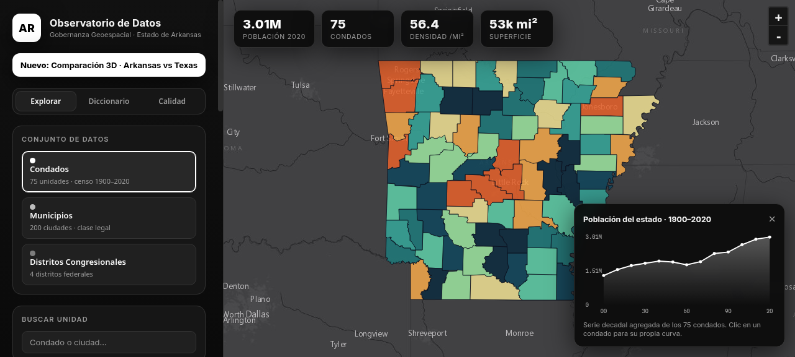
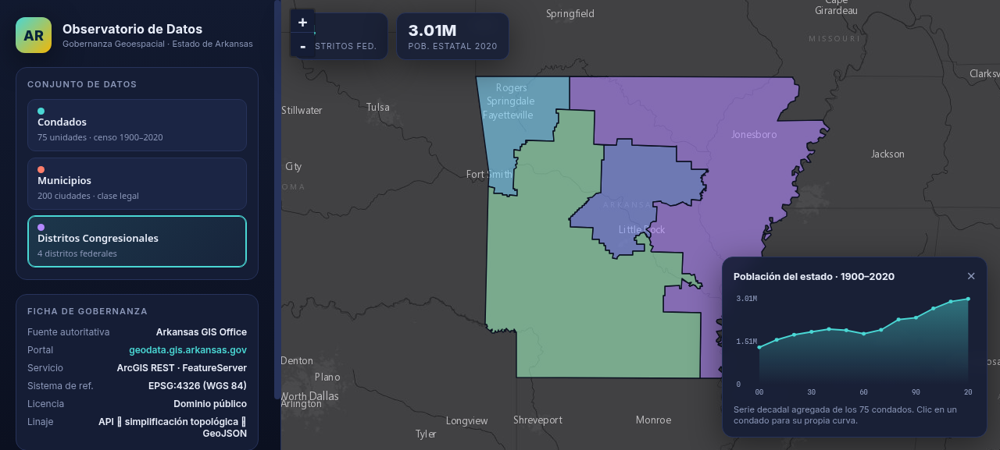
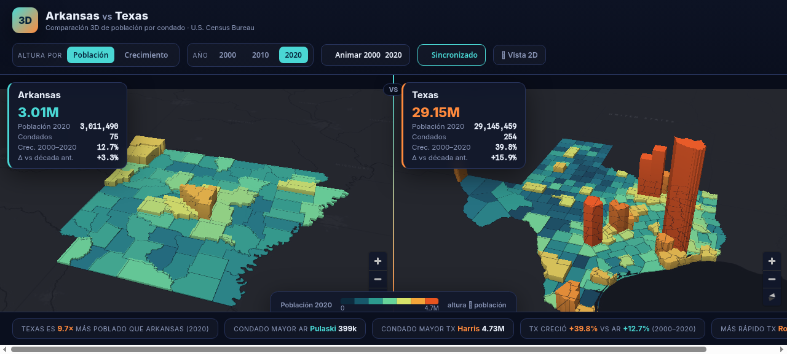
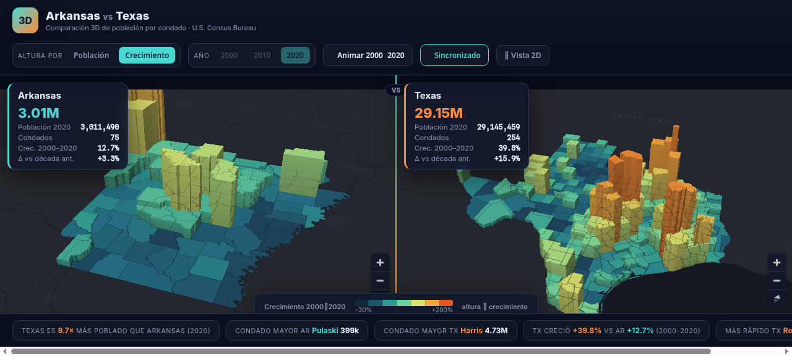
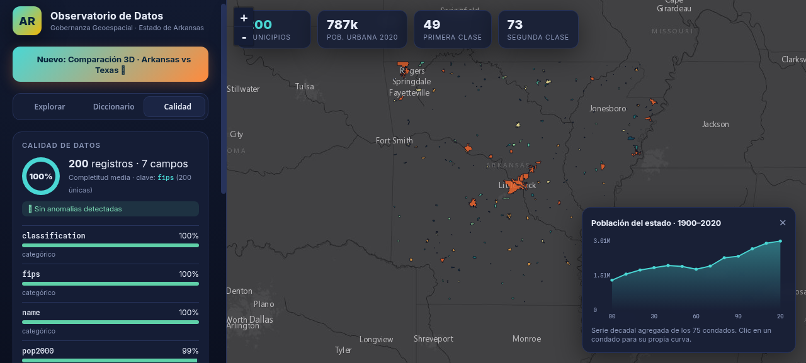
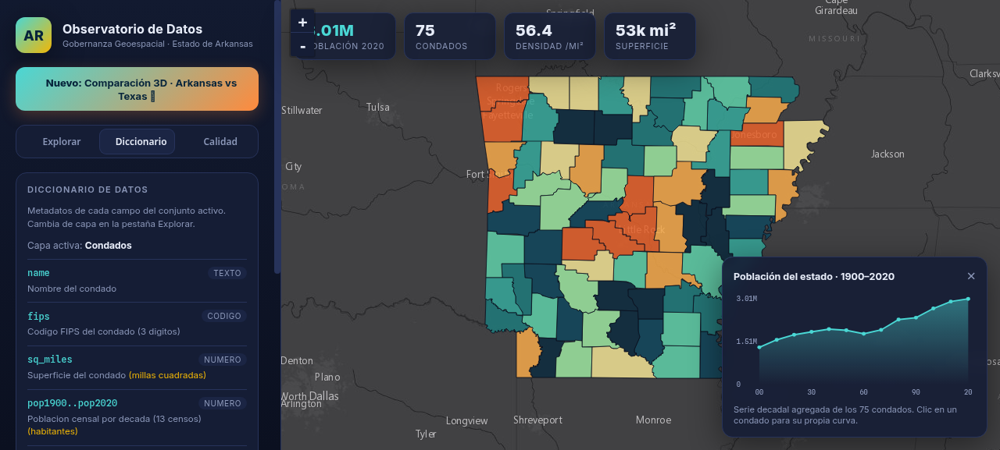

# 🗺️ Observatorio de Gobernanza de Datos Geoespaciales · Arkansas

Visualización web **interactiva** de los límites administrativos del estado de
**Arkansas (EE. UU.)**, construida con datos abiertos y oficiales bajo un enfoque
de **gobernanza de datos** (fuente autoritativa, linaje, CRS y licencia documentados).

> ℹ️ Nota: *Arkansas* es un **estado** de EE. UU., no una ciudad de Texas. El portal
> `geodata.gis.arkansas.gov` es el catálogo oficial de datos geoespaciales de ese estado.




## 🏙️ NUEVO · Comparación 3D: Arkansas vs Texas (`web/compare3d.html`)

Dos mapas **3D** sincronizados que extruyen cada condado según su **población** (o
su **crecimiento 2000→2020**), para comparar visualmente dos estados de escala muy
distinta. Datos del **U.S. Census Bureau** (geometría TIGERweb + Population Estimates),
100 % comparables entre estados.




- 🧊 **Extrusión 3D** (altura ∝ población o crecimiento) con color secuencial
- 🔗 **Cámaras sincronizadas** (rotar/zoom/inclinar ambos mapas a la vez) — conmutable
- 🕰️ **Años 2000 / 2010 / 2020** + botón de **animación**
- 🪧 **Hover** con cifras por condado y 📊 **tira de insights** automática
  (p. ej. *Texas es 9.7× más poblado que Arkansas*)

| | Condados | Pob. 2020 | Crecimiento 2000–2020 | Condado mayor |
|--|--|--|--|--|
| **Arkansas** | 75 | 3.01 M | +12.7 % | Pulaski (399 k) |
| **Texas** | 254 | 29.15 M | +39.8 % | Harris (4.73 M) |

> Fuentes keyless: [TIGERweb](https://tigerweb.geo.census.gov/) para geometría y los
> archivos estáticos de *Population Estimates* de `www2.census.gov` para población.

## ✨ Qué muestra

Tres conjuntos de datos oficiales, conmutables desde la barra lateral:

| Capa | Unidades | Riqueza del dato |
|------|----------|------------------|
| **Condados** | 75 | Población censal por década **1900–2020** |
| **Municipios** | 200 | Clasificación legal (Primera/Segunda clase, Incorporado) y población 2000–2020 |
| **Distritos Congresionales** | 4 | División federal de la Cámara de Representantes |

### Interactividad (lo que es un *MUST*)
- 🎨 **Mapa coroplético** con escala de cuantiles (población / densidad / crecimiento).
- 🫧 **Burbujas proporcionales** opcionales (centroides dimensionados por población).
- 🔎 **Buscador** de condados y municipios con zoom y resaltado.
- 📊 **Ranking Top-10** clicable según la métrica activa.
- 🕰️ **Línea de tiempo animada**: desliza o reproduce la evolución de 1900 a 2020.
- 📈 **Gráficos históricos**: serie del estado y, al hacer clic en un condado, su propia curva de 120 años.
- 🧭 **KPIs en vivo** que se recalculan según la capa y el año.
- 🪧 **Tarjetas al pasar el cursor** con cifras de cada unidad.

### Pestañas de gobernanza
- 📋 **Diccionario de datos** — metadatos (tipo, descripción, unidad) de cada campo.
- ✅ **Calidad de datos** — completitud por campo, nulos, rangos, claves únicas y anomalías
  (p. ej. detecta que `pop2000` de los municipios está al 99 %: 2 registros nulos).
- ⬇️ **Exportar** la capa activa a **GeoJSON** o **CSV**, y 🔖 **citar** la fuente al portapapeles.
- 🏛️ **Ficha de Gobernanza** fija con fuente, servicio, CRS (EPSG:4326), licencia y linaje.




## 🏛️ Gobernanza de datos

| Atributo | Valor |
|----------|-------|
| Fuente autoritativa | Arkansas GIS Office |
| Portal | https://geodata.gis.arkansas.gov/ |
| Servicio | ArcGIS REST · `FEATURESERVICES/Boundaries/FeatureServer` |
| Sistema de referencia | EPSG:4326 (WGS 84) |
| Licencia | Dominio público |
| Linaje | API REST → simplificación topológica (Shapely) → GeoJSON compacto |

Las geometrías originales (~17 MB) se simplificaron preservando la topología a
**~280 KB** totales, para una carga web instantánea sin perder fidelidad visual.

## 🚀 Uso local

```bash
# 1) (Opcional) regenerar los datos desde las APIs oficiales
pip install --target=.pylibs shapely
PYTHONPATH=.pylibs python3 scripts/process_data.py   # Arkansas (vista 2D)
PYTHONPATH=.pylibs python3 scripts/build_compare.py  # AR vs TX (vista 3D)
#   ambos scripts descargan los datos crudos a ./data automáticamente

# 2) servir la app
cd web
python3 -m http.server 8099
# vista 2D:  http://localhost:8099/index.html
# vista 3D:  http://localhost:8099/compare3d.html
```

## 📁 Estructura

```
GobDatos/
├── scripts/
│   ├── process_data.py       # ETL vista 2D: Arkansas GIS → GeoJSON + stats
│   └── build_compare.py      # ETL vista 3D: US Census (AR+TX) → GeoJSON + stats
├── data/                     # datos crudos de las APIs (no versionados)
└── web/
    ├── index.html / style.css / app.js      # vista 2D (Leaflet)
    ├── compare3d.html / .css / .js          # vista 3D comparativa (MapLibre)
    └── data/                                # datasets procesados servidos al navegador
        ├── counties.geojson · municipalities.geojson · congress.geojson · stats.json
        └── compare.geojson · compare_stats.json
```

## 🛠️ Tecnología
- [Leaflet](https://leafletjs.com/) para la vista 2D · [MapLibre GL JS](https://maplibre.org/) para la 3D
- Basemaps sin API key: Esri *World Dark Gray*
- SVG puro para los gráficos (sin dependencias de charting)
- [Shapely](https://shapely.readthedocs.io/) para la simplificación geométrica

---
Datos: **Arkansas GIS Office** (vista 2D) y **U.S. Census Bureau** (vista 3D) · dominio público.
